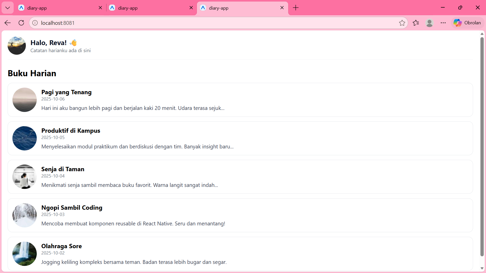
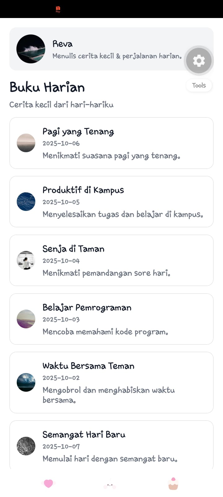
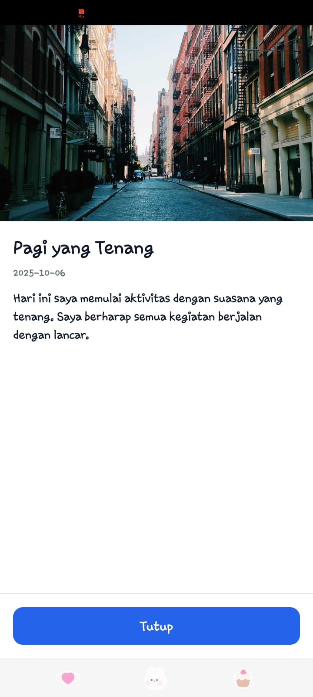
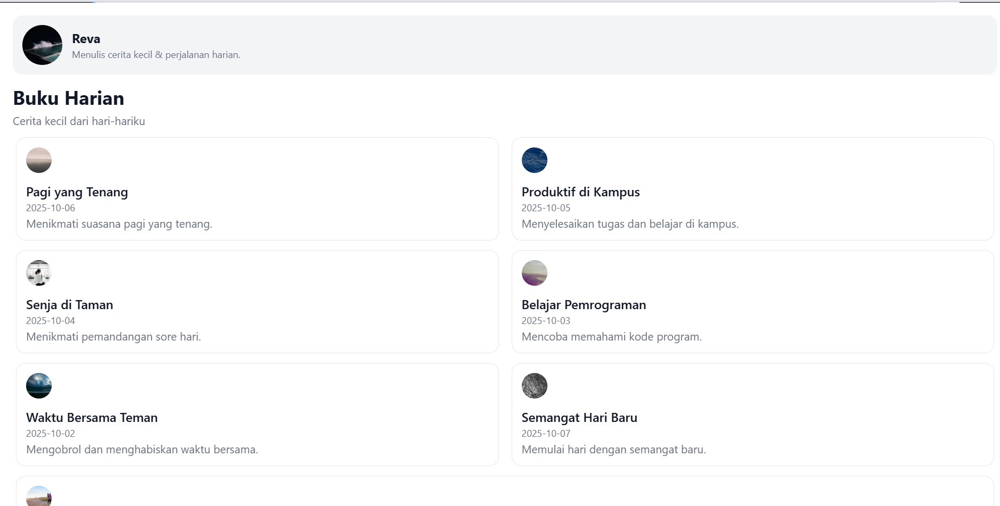

# Diary App - React Native

Aplikasi catatan buku harian (Diary App) berbasis React Native & Expo untuk mencatat kegiatan harian dan suasana hati .

## Data Mahasiswa
- **Nama**: Reva Dwi Nurrahma
- **NIM**: 2430511041
- **Kelas**: 5C

---

## Fitur yang Diselesaikan
1. **Header Profile**: Menambahkan avatar, nama, dan bio profil pengakses di bagian atas aplikasi.
2. **Komponen Reusable**: Mengembangkan komponen `DiaryCard` untuk menampilkan entri diary secara konsisten.
3. **Refactoring UI & Design System**: Memperbarui tata letak halaman menggunakan *design tokens* terpusat (`tokens.js`) untuk warna, spasi, dan tipografi.
4. **Responsive Layout**:
   - **Mode HP (< 600px)**: Tampilan daftar 1 kolom (*list view*).
   - **Mode Tablet / Web (≥ 600px)**: Tampilan grid 2 kolom (*grid view*) dinamis menggunakan `useWindowDimensions`.
5. **Detail Entry Modal**: Pop-up modal interaktif (`DiaryDetailModal`) untuk membaca catatan harian secara lengkap beserta gambar header.
6. **Ekspansi Data & Online Assets**: Menyajikan daftar entri catatan harian dengan integrasi gambar *placeholder* online (`Picsum Photos`).
7. **Dukungan Cross-Platform**: Mengonfigurasi aplikasi agar dapat dijalankan secara lancar di Expo Go (Android/iOS) dan browser web.
8. **Version Control**: Mengintegrasikan proyek dengan Git dan memperbarui repositori GitHub ([revadn-lgtm/diary-app](https://github.com/revadn-lgtm/diary-app.git)).

## 🛠️ Layar & Komponen

- `App.js`: *Entry point* aplikasi.
- `src/screens/DiaryListScreen.js`: Layar utama daftar catatan harian.
- `src/components/DiaryCard.js`: Komponen kartu catatan harian.
- `src/components/DiaryDetailModal.js`: Komponen modal detail entri.
- `src/styles/tokens.js`: Sistem token untuk warna, spasi, dan *breakpoint*.

---

## Langkah Menjalankan Proyek
1. **Clone Repository**
   ```bash
   git clone [https://github.com/revadn-lgtm/diary-app.git](https://github.com/revadn-lgtm/diary-app.git)
   cd diary-app
2. **install dependensi**
   ```bash
   npm install
3. **jalankan proyek**
    ```bash
    npx expo start -c
   

## Tampilan Aplikasi


## 📱 Tampilan Aplikasi

### 1. Tampilan Utama


### 2. Tampilan Detail Modal


### 3. Tampilan Grid Mode


